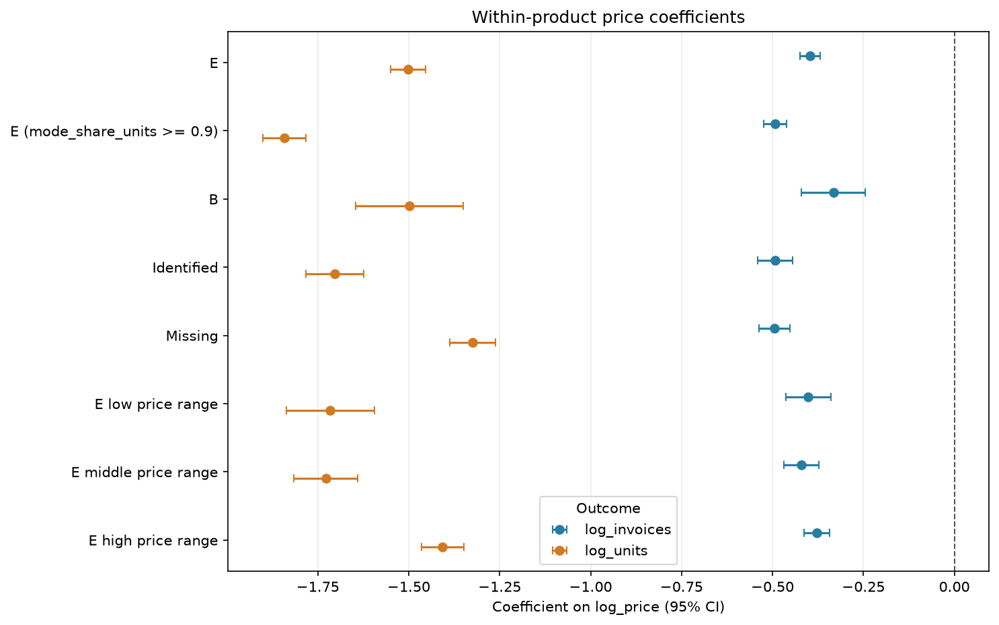
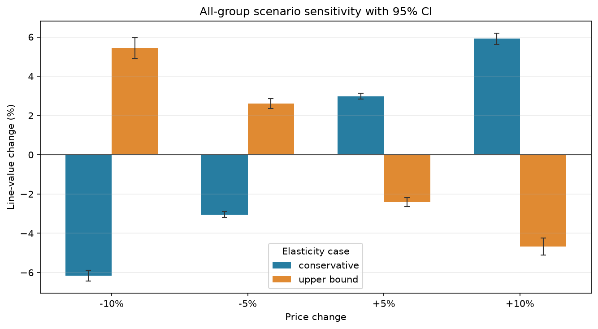

# Pricing and recorded quantity

This project uses the UCI Online Retail workbook to describe transaction
patterns, clean a reproducible population, investigate weekly price variation,
and estimate within-product associations between weekly modal price and
recorded quantities. Interpret the results as association, not causal;
recorded quantity is not verified demand.

## Key findings

- The headline within-product invoice coefficient is **-0.397409** (clustered
  SE **0.014191**).
- Invoice coefficients range from **-0.31 to -0.49 across notebooks 04 and
  05**.
- The headline units coefficient is **-1.502479** (clustered SE **0.024650**).
- **46.08%** of product-weeks contain multiple recorded prices; in **83.39%**
  of those, median line quantity is larger at the lowest price.
- **34.7%** of identified lines with `Quantity >= 24` are priced below the
  product median.


*Coefficient estimates and their uncertainty intervals.*


*Estimated line-value changes under the conservative and upper-bound scenarios.*

## Data source

The source is the UCI Online Retail dataset, provided as `Online Retail.xlsx`
at the expected path `data/raw/`. The workbook is tracked in this repository.

## Current notebook workflow

Run the notebooks from the repository root in this order:

1. [`notebooks/01_data_understanding.ipynb`](notebooks/01_data_understanding.ipynb)
   profiles the raw workbook and investigates transaction types and anomalies.
2. [`notebooks/02_cleaning.ipynb`](notebooks/02_cleaning.ipynb) compares raw
   product rankings, builds the clean population, matches exact cancellations,
   and screens unmatched cancellations for possible partial-return candidates.
3. [`notebooks/03_price_variation.ipynb`](notebooks/03_price_variation.ipynb)
   aggregates clean lines to product-weeks and describes mixed prices,
   deviations from reference prices, and price/quantity associations.
4. [`notebooks/04_elasticity.ipynb`](notebooks/04_elasticity.ipynb) defines
   product-week samples and estimates product- and week-adjusted associations.
5. [`notebooks/05_price_tiers.ipynb`](notebooks/05_price_tiers.ipynb) compares
   price ratios and within-product estimates by CustomerID status.
6. [`notebooks/06_scenarios_and_figures.ipynb`](notebooks/06_scenarios_and_figures.ipynb)
   calculates conservative and upper-bound scenarios and creates the report
   figures.

`notebooks/archive/` contains superseded notebooks and is not part of the
current run order.

## Data and cleaning

The source is `data/raw/Online Retail.xlsx`. The raw workbook has 541,909
invoice-line rows across eight fields, dated 2010-12-01 through 2011-12-09.
The initial profile reports 25,900 invoices, 4,070 stock codes, 38 countries,
and 135,080 rows with missing `CustomerID`.

The clean-data workflow excludes `C` invoices, keeps positive quantity and
price, keeps product-like stock codes matching five digits with optional
letters, then removes only positive lines matched one-to-one to an earlier
cancellation for the same identified customer, stock code, and exact
quantity. Positive lines with missing `CustomerID` remain in the clean
population but cannot be matched by customer.

The printed row waterfall is **541,909 → 532,621 → 530,104 → 527,725 →
524,894**. The clean population has 3,786 products and 5,351,288 units.
Of 8,905 cancellation lines considered, 2,831 matched and 6,074 did not.
Among unmatched cancellations, 4,572 have a larger eligible earlier purchase
(23,914 cancellation units); these are candidates, not confirmed partial
returns.

## Completed analyses and printed results

- **Weekly price variation:** the product-week table has 100,068 rows.
  46,112 (46.08%) contain multiple recorded prices, accounting for 4,267,571
  units. In 38,453 of those 46,112 product-weeks (83.39%), median line
  quantity is larger at the lowest price than at the highest price.
- **Final model choice:** within-product OLS with week effects
  (`src.models.fit_within_product`) on Sample E. The headline `log_invoices`
  coefficient is -0.397409 (clustered SE 0.014191). Invoice coefficients
  range from about -0.31 to -0.49 across notebooks 04 and 05.
- **Units and order size:** in Sample E, the `log_units` coefficient is
  -1.502479 (clustered SE 0.024650). In the Sample B decomposition,
  `log_invoices` is -0.332338 (0.044845), while `log_units_per_invoice` is
  -1.165481 (0.048999). The stronger association is with units per invoice,
  i.e. order size; these two components sum to the Sample B `log_units`
  coefficient of -1.497819.
- **CustomerID price patterns:** among 517,559 qualifying lines, 128,801 have
  missing CustomerID and 388,758 have a recorded CustomerID. Across quantity
  buckets, median price ratios are 1.000 for the identified group and 1.920
  to 2.000 for the missing-ID group. This is evidence of distinct price
  patterns, not proof of non-overlapping tiers; interpreting missing IDs as a
  retail tier remains a hypothesis. The within-product `log_invoices`
  coefficients are -0.493074 for identified lines and -0.494630 for missing
  CustomerID lines.

## Figures

- `reports/figures/fig1_cleaning_waterfall.png` — clean-row filtering waterfall.
- `reports/figures/fig2_price_ratio_by_quantity.png` — price ratios by quantity bucket and CustomerID status.
- `reports/figures/fig3_coefficient_plot.png` — coefficient estimates with uncertainty intervals.
- `reports/figures/fig4_example_products.png` — example product price and quantity patterns.
- `reports/figures/fig5_scenarios.png` — scenario changes in line value across price changes.

## Scenario analysis

The All-group scenarios use the invoice coefficient as the conservative case,
holding units per invoice constant, and the units coefficient as the upper
bound. The table reports percentage changes in line value (`price x quantity`)
for the indicated price change. Intervals are 95% CIs from the coefficient
uncertainty only.

| Price change | Conservative | 95% CI | Upper bound | 95% CI |
|---:|---:|---:|---:|---:|
| -10% | -6.152% | [-6.426%, -5.876%] | 5.437% | [4.901%, 5.975%] |
| -5% | -3.044% | [-3.182%, -2.905%] | 2.611% | [2.357%, 2.865%] |
| +5% | 2.984% | [2.844%, 3.124%] | -2.422% | [-2.652%, -2.192%] |
| +10% | 5.911% | [5.631%, 6.193%] | -4.676% | [-5.114%, -4.236%] |

The two bounds have opposite signs, so no price-direction recommendation is
supported. The units elasticity is probably overstated because large orders
carry lower prices: **34.7%** of identified lines with `Quantity >= 24` are
priced below the product median. Line value is price x quantity, not revenue
or profit, and there is no cost data.

## Reusable code

- `src/clean.py` provides raw/clean loaders, stock-code normalization, and
  one-to-one cancellation matching.
- `src/features.py` builds the product-week feature table, including units,
  invoice counts, distinct prices, and the modal price.
- `src/models.py` provides `fit_within_product`, which demeans by product,
  includes week effects, and clusters standard errors by `StockCode`.

## Setup and execution

From the repository root:

```powershell
python -m venv .venv
.\.venv\Scripts\Activate.ps1
python -m pip install -r requirements.txt
jupyter lab
```

Run notebooks 01 through 06 from top to bottom.

## Limitations

- Product-weeks with zero recorded sales are absent, so the invoice
  coefficient describes weeks in which the product sold at least once.
- Weekly modal price is not exogenous: promotions, seasonality, and customer
  mix can move price and quantity together, so estimates are associations.
- Weekly modal prices can mix the identified and missing-CustomerID price
  patterns and hide transaction-level variation.
- The workbook does not report stock availability or costs, and recorded
  quantity is not verified demand.
- The observed period is limited to the workbook's dates; longer histories
  could test persistence.

## Future work

- Include zero-sales weeks.
- Obtain transaction-level prices and discounts.
- Build a Power BI dashboard.
- Add cost data for profit analysis.
- Extend the analysis with a longer history.
- Develop a causal design.
